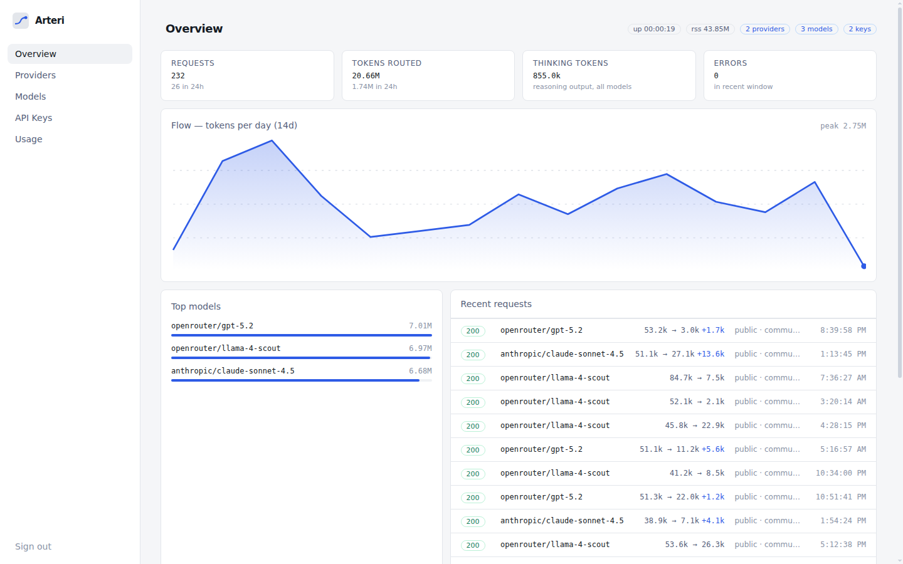
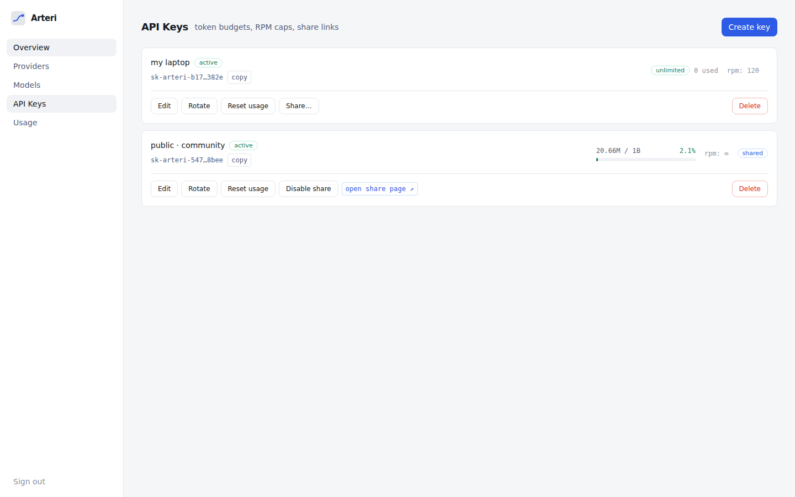
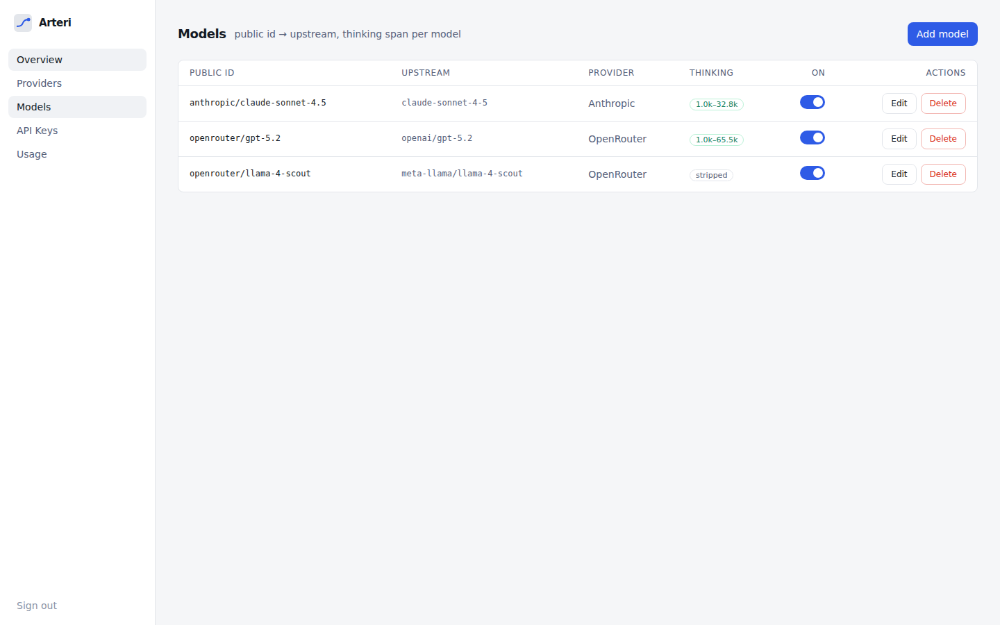
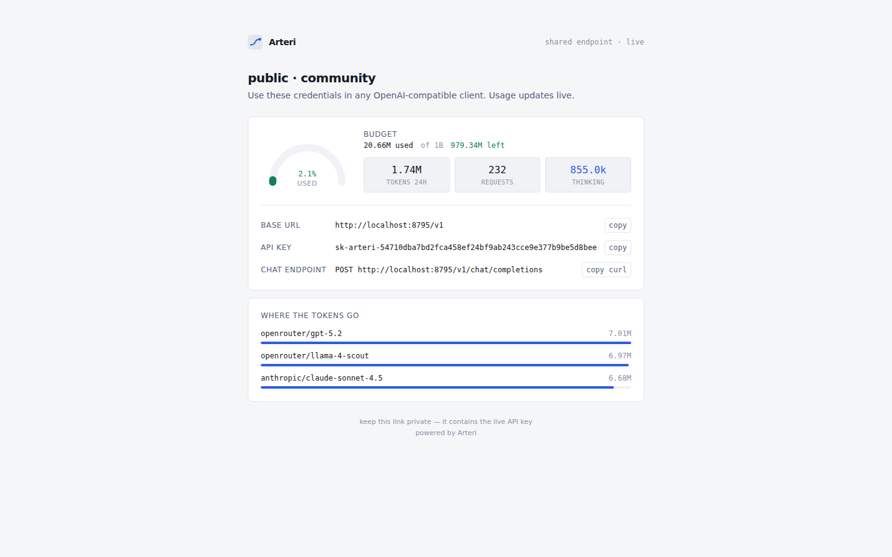

# Arteri

**A self-hosted AI router with a public share page.** Point any OpenAI-compatible tool at one endpoint, back it with any provider, and hand out API keys with hard token budgets — each key gets a shareable link that shows its base URL, API key, and live remaining quota.

Clean professional dashboard. One Bun process. Zero native deps beyond Hono.

<p align="center">
  
</p>

## Why

- **Custom base URL + API key per provider** — OpenAI-compatible (`…/v1`) or Anthropic-native upstreams, extra headers supported.
- **Thinking engine** — clients ask with `reasoning_effort` (OpenAI-style) or `thinking.budget_tokens` (Anthropic-style); Arteri normalizes both and clamps to each model's configured min/max budget. Models without thinking support get the fields stripped.
- **Keys as products** — cumulative token budgets (e.g. 1B), RPM caps, model allowlists. Perfect for sharing a pool with friends or a community without burning it.
- **Public share pages** — every key can publish a read-only page: base URL, key, gauge of used/remaining %, per-model token split. Live.

## Screenshots

| Overview | API Keys |
| --- | --- |
|  |  |

| Model + thinking config | Public share page |
| --- | --- |
|  |  |

## Quick start

Requires [Bun](https://bun.sh) 1.2+.

```bash
bun install
cd web && bun run build && cd ..     # build the dashboard once
cp .env.example .env                 # set ADMIN_PASSWORD (optional)
bun run start
```

First boot prints a generated console password if none is set. Then:

```bash
# 1. log in at http://localhost:8787
# 2. add a provider (name, base URL, API key)
# 3. add models (public id -> upstream id, thinking span)
# 4. create a key, optionally set a budget like 1000000000
```

Point your tools at it:

```bash
curl http://localhost:8787/v1/chat/completions \
  -H "Authorization: Bearer sk-arteri-..." \
  -H "content-type: application/json" \
  -d '{"model":"openrouter/gpt-5.2","messages":[{"role":"user","content":"hello"}],"reasoning_effort":"high"}'
```

## The thinking engine

Configure a span per model — say `min 1024, max 65536`. Clients may ask however they like:

| Client sends | Meaning |
| --- | --- |
| `"reasoning_effort": "low"/"medium"/"high"/"xhigh"` | named effort levels |
| `"reasoning_effort": "minimal"` / `none` / numeric | fine-grained effort |
| `"thinking": {"type":"enabled","budget_tokens":16384}` | Anthropic-style budget |
| nothing | passed through untouched (no silent default burn) |

Arteri maps any request onto a log-scale fraction of the model's `[min, max]` span and emits the right shape for the upstream dialect. Unsupported models have every thinking field stripped before forwarding. Thinking/reasoning tokens are metered separately in usage stats.

## Share pages

Toggle **Share** on any key → you get `/share/<slug>`:

- base URL and full API key (that's the point — it's a distribution link)
- half-circle gauge: used vs. limit, e.g. `250M of 1B = 25%`
- tokens last 24h, total requests, total thinking tokens
- per-model breakdown with bars

The link is capability: whoever has it, has the key. Disable from the dashboard anytime.

## Surfaces

| Route | Purpose |
| --- | --- |
| `POST /v1/chat/completions` | OpenAI Chat Completions (streaming + JSON) |
| `POST /v1/messages` | Anthropic Messages alias |
| `GET /v1/models` | models allowed for the presented key, with thinking metadata |
| `/share/<slug>` | public live usage page |
| `/console` | dashboard (overview, providers, models, keys, usage) |

Errors are relayed in OpenAI error shape; provider errors pass through verbatim so client SDKs parse them natively.

## Architecture

One process, two layers:

```
server/            Hono + bun:sqlite (WAL). No ORM, no schema lib.
  src/proxy.ts     auth -> limits -> resolve -> translate -> stream tap -> meter
  src/thinking.ts  effort normalization + clamping for both dialects
  src/admin.ts     console API (session cookie + optional x-admin-key, login rate-limited)
  src/share.ts     public share reads
web/               Vite + React 19 + TanStack Router/Query + Tailwind v4
```

- Streaming uses a pass-through `TransformStream` that taps SSE chunks for usage and records on flush — zero buffering of the payload.
- Usage is counted per request into SQLite and rolled up per key; limits are enforced pre-flight.
- Design tokens live in one CSS file (`web/src/tokens.css`); no component library.

## Configuration

| Env | Default | Meaning |
| --- | --- | --- |
| `PORT` | `8787` | HTTP port |
| `DATA_DIR` | `./data` | SQLite location |
| `ADMIN_PASSWORD` | generated | console password (env wins so Docker users can rotate) |
| `ADMIN_API_KEY` | – | static header key for scripting the admin API |
| `PUBLIC_BASE_URL` | request-derived | base URL shown on share pages (set behind a proxy) |

## Deploy

**Docker**

```bash
docker compose up -d   # mounts ./data volume, port 8787
```

Behind nginx/Caddy: terminate TLS, forward to `PORT`, and set `PUBLIC_BASE_URL=https://your.host`.

## Development

```bash
bun run dev          # server :8787 (hot) + vite :5173 (proxied)
bun test             # E2E against a mock upstream — boots the real pipeline
bun run check        # tsc for both workspaces
```

## License

MIT
